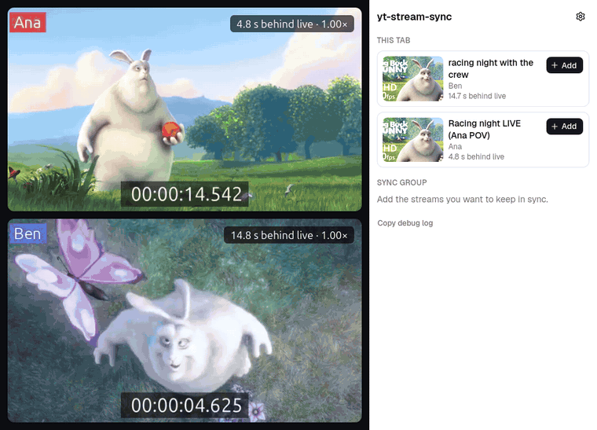

<div align="center">


# yt-stream-sync

**Watch several YouTube streams of the same collab side by side, in sync.**<br />
A Firefox add-on that lines up live streams and archives, keeps them together as you watch,
and remembers groups of archives for later.

[](https://github.com/ZXY101/yt-stream-sync/actions/workflows/checks.yml)
[](https://github.com/ZXY101/yt-stream-sync/releases)
[](LICENSE)
[](#installation)
[](package.json)
[](https://www.conventionalcommits.org/)

[Features](#features) ·
[Installation](#installation) ·
[Usage](docs/usage.md) ·
[Privacy](docs/privacy.md) ·
[Contributing](CONTRIBUTING.md)

<br />



<sub>The real add-on syncing two stand-in players that play Big Buck Bunny (© Blender Foundation,
CC BY) and report their delay the way YouTube's player does.</sub>

</div>

---

## What is this?

When several streamers play together, each one streams their own view. Watching two or three of
those side by side only works if they show the same moment, and they rarely do: each stream has
its own delay, and archives start at different times.

yt-stream-sync keeps them together. Add each stream from the toolbar popup and it does the
rest: it slows down whichever live stream is ahead, lines archives up by broadcast time, and
fine-tunes by listening for the sound they share. Seek or pause one archive and the others
follow.

> [!NOTE]
> yt-stream-sync is young (0.x) and Firefox-only for now. Chrome support is planned.

## Features

- **Live streams:** the stream that's ahead is slowed (or briefly paused) until they match.
  Live streams are never sped up, so they don't stall.
- **Archives:** lined up by when each broadcast started. Seek, pause, play or change speed on
  one and the others follow.
- **Audio matching:** listens to the streams and lines up the sound they share.
- **Nudges and offsets:** move any stream ahead or back by 0.1, 1 or 10 s, or type an offset.
- **Saved groups:** save a group of archives and pick up later where you stopped, at the same
  offsets. Manage them on their own page.
- **Embeds:** works on watch pages and on YouTube players embedded in other sites, such as
  multiview pages.
- **Optional yt-dlp-z alignment:** archives minutes apart can be lined up by your own
  [yt-dlp-z](https://github.com/ZXY101/yt-dlp-z) server.
- **Private:** no data collection, no analytics, audio analysed in memory only. See the
  [privacy policy](docs/privacy.md).

## Installation

Needs **Firefox 142** or newer (desktop).

### From Firefox Add-ons

Coming soon: the add-on is waiting for review on addons.mozilla.org.

### From a release

1. Download `yt-stream-sync-<version>.zip` from the
   [latest release](https://github.com/ZXY101/yt-stream-sync/releases/latest).
2. Open `about:debugging#/runtime/this-firefox`, click **Load Temporary Add-on…** and pick the
   zip.

Temporary add-ons are removed when Firefox closes. To keep it installed, use Firefox Developer
Edition or Nightly: set `xpinstall.signatures.required` to `false` in `about:config`, then
install the zip from `about:addons` → gear icon → **Install Add-on From File…**.

### From source

See the [development guide](docs/development.md): `npm ci`, `npm run build`, then load
`dist/manifest.json` as above.

## Quick start

1. Open two streams of the same collab in two tabs.
2. In the first tab, click the yt-stream-sync button and **Add**.
3. Switch to the second tab and **Add** it too.

The popup now shows both streams and what the sync is doing to each. The
[usage guide](docs/usage.md) covers archives, offsets, audio matching, saved groups and
troubleshooting.

## Documentation

| Guide                                                 | What's in it                                                   |
| ----------------------------------------------------- | -------------------------------------------------------------- |
| [Usage](docs/usage.md)                                | Adding streams, live vs archives, offsets, saved groups, fixes |
| [Aligning with yt-dlp-z](docs/align-with-yt-dlp-z.md) | Lining up archives minutes apart with your own yt-dlp-z server |
| [Privacy policy](docs/privacy.md)                     | What is stored, read and sent                                  |
| [Permissions](docs/permissions.md)                    | Every permission and why it's needed                           |
| [Development](docs/development.md)                    | Setup, commands, how the build works, tests                    |

## How it works

```
Popup / saved groups page ──▶ Background script (sync, audio matching, saved groups)
                                   ▲ │  reports every second, commands back
                                   │ ▼
                              Content script  ──▶  Page script  ──▶  YouTube player
```

Each YouTube frame reports its player's state about once a second. The background script
decides what each added player should do (slow down, pause, seek, play) and sends commands
back. Messages from the page are checked before they're used, and only the popup can change
the sync group. Audio is captured at 2 kHz and compared in memory to measure the delay between
streams.

## Contributing

Bug reports, ideas and pull requests are welcome. Read [CONTRIBUTING.md](CONTRIBUTING.md), the
[development guide](docs/development.md) and [AGENTS.md](AGENTS.md) first. Found a security
problem? See [SECURITY.md](SECURITY.md).

## Disclaimer

yt-stream-sync isn't affiliated with YouTube or Google. It only controls players in your own
browser.

## License

[The Unlicense](LICENSE): public domain.
